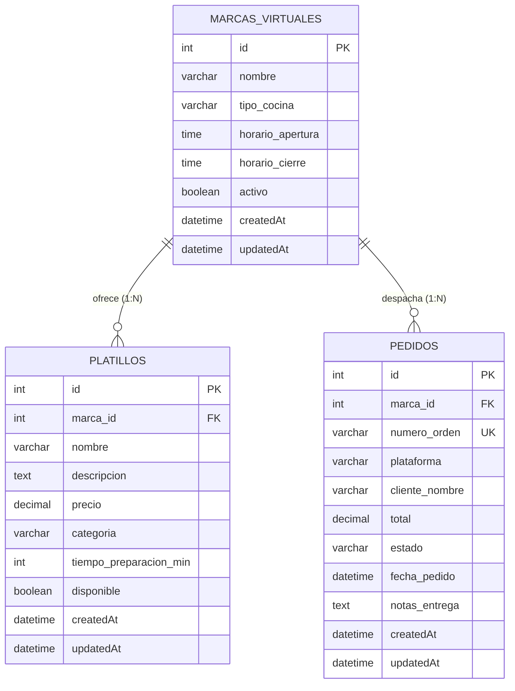

# DarkKitchen Hub
## Justificación y descripción del sistema empresarial

### 1. Nombre del sistema

**DarkKitchen Hub**

Sistema empresarial orientado a la gestión operativa de cocinas ocultas (*Dark Kitchens*), que permite organizar y administrar información relacionada con las marcas virtuales y sus pedidos.

### 2. Problemática empresarial

Las cocinas ocultas son establecimientos gastronómicos que preparan alimentos exclusivamente para pedidos a domicilio, sin contar necesariamente con un espacio físico de atención al público.

Una de las principales dificultades de este modelo de negocio es la gestión de varias marcas virtuales y sus respectivos pedidos desde una misma operación de cocina.

Cuando la información se administra de manera manual o desorganizada, pueden presentarse problemas como:

- Dificultad para administrar varias marcas virtuales.
- Desorganización de las categorías y platillos disponibles.
- Problemas para consultar y actualizar la información de los pedidos.
- Dificultad para mantener la información centralizada.
- Mayor posibilidad de cometer errores durante la gestión operativa.

### 3. Justificación del sistema

DarkKitchen Hub surge como una solución para mejorar la organización y administración de las operaciones de las cocinas ocultas.

El sistema permitirá centralizar la información de las marcas virtuales y facilitar la gestión de sus datos mediante operaciones CRUD (Crear, Leer, Actualizar y Eliminar).

De esta manera, los responsables de la operación podrán registrar nuevas marcas, consultar la información existente, actualizar datos y eliminar registros cuando sea necesario.

Además, permitirá administrar la información relacionada con los pedidos, facilitando su consulta y mantenimiento.

### 4. Alcance del sistema

El proyecto se enfocará en desarrollar un sistema empresarial con las siguientes funcionalidades:

- **Gestión de marcas virtuales:** registrar, consultar, actualizar y eliminar marcas.
- **Gestión de categorías del menú:** administrar las categorías asociadas a cada marca.
- **Gestión de platillos:** mantener organizada la información de los productos ofrecidos.
- **Gestión de pedidos:** registrar, consultar, actualizar y eliminar información relacionada con los pedidos.
- **Organización de la información:** mantener los datos almacenados en una base de datos y relacionados entre sí.

### 5. Tecnologías

El sistema será desarrollado utilizando las siguientes tecnologías:

- **Backend:** Node.js y Express para desarrollar la API REST.
- **Frontend:** React para construir la interfaz de usuario.
- **Base de datos:** un gestor de base de datos relacional para almacenar la información.
- **Comunicación:** intercambio de información mediante JSON.

### 6. Consideraciones del proyecto

DarkKitchen Hub se desarrollará sin implementar mecanismos de autenticación.

Por lo tanto, no contará con inicio de sesión, registro de usuarios, tokens ni gestión de roles. El enfoque principal será la administración de la información empresarial mediante operaciones CRUD completas.

### 7. Objetivo general

Desarrollar un sistema empresarial que facilite la gestión y organización de marcas virtuales y pedidos de cocinas ocultas, mediante una aplicación web que permita administrar la información de manera centralizada y eficiente.


---

## 8. Modelado de datos empresarial (Día 1)

### 8.1. Entidades candidatas identificadas
Para responder a la problemática de una cocina oculta (*Dark Kitchen*), se identificaron inicialmente ocho entidades candidatas:

1. **`marcas_virtuales` (Seleccionada):** Representa cada marca comercial o concepto culinario que opera dentro de la cocina oculta.
2. **`platillos` (Seleccionada):** Catálogo de productos y recetas ofrecidas en el menú de cada marca.
3. **`pedidos` (Seleccionada):** Órdenes de compra generadas por los clientes a través de las distintas plataformas de delivery.
4. **`categorias`:** Clasificación interna de los platillos (entradas, principales, bebidas, postres).
5. **`detalles_pedido`:** Desglose línea por línea de los platillos y cantidades solicitadas en una orden.
6. **`plataformas_delivery`:** Canales externos de comercialización (Uber Eats, Rappi, Didi Food).
7. **`estaciones_cocina`:** Puestos físicos de preparación en la cocina (freidoras, planchas, armado).
8. **`inventario_insumos`:** Control de stock y materia prima empleada en las recetas.

---

### 8.2. Selección de entidades principales
Se seleccionaron las **tres entidades núcleo** indispensables para garantizar el flujo operativo del sistema sin sobrecargar la arquitectura en esta primera fase:

* **Entidad 1: `marcas_virtuales`** (Entidad matriz de la operación).
* **Entidad 2: `platillos`** (Oferta gastronómica dependiente de cada marca).
* **Entidad 3: `pedidos`** (Gestión comercial y despacho dependiente de cada marca).

---

### 8.3. Diccionario de datos y especificación de atributos

#### Tabla: `marcas_virtuales`
Almacena las diferentes marcas comerciales administradas por la cocina oculta.

| Campo | Tipo de dato | Nulo | Clave | Valor por defecto | Descripción |
| :--- | :--- | :---: | :---: | :---: | :--- |
| `id` | INT | NO | **PK** (AI) | — | Identificador único de la marca. |
| `nombre` | VARCHAR(100) | NO | UNIQUE | — | Nombre comercial de la marca virtual. |
| `tipo_cocina` | VARCHAR(50) | NO | — | — | Especialidad (ej: Hamburguesas, Sushi, Mexicana). |
| `horario_apertura` | TIME | NO | — | — | Hora de inicio de operaciones (HH:MM:SS). |
| `horario_cierre` | TIME | NO | — | — | Hora de finalización de operaciones (HH:MM:SS). |
| `activo` | BOOLEAN | NO | — | `true` | Estado operativo de la marca (abierta/cerrada). |
| `createdAt` | DATETIME | NO | — | CURRENT_TIMESTAMP | Fecha y hora de registro. |
| `updatedAt` | DATETIME | NO | — | CURRENT_TIMESTAMP | Fecha y hora de última modificación. |

#### Tabla: `platillos`
Almacena los productos que forman parte del menú de cada marca virtual.

| Campo | Tipo de dato | Nulo | Clave | Valor por defecto | Descripción |
| :--- | :--- | :---: | :---: | :---: | :--- |
| `id` | INT | NO | **PK** (AI) | — | Identificador único del platillo. |
| `marca_id` | INT | NO | **FK** | — | Referencia a `marcas_virtuales(id)`. |
| `nombre` | VARCHAR(120) | NO | — | — | Nombre del platillo o combo. |
| `descripcion` | TEXT | SÍ | — | NULL | Descripción detallada de ingredientes. |
| `precio` | DECIMAL(10,2) | NO | — | — | Precio unitario de venta. |
| `categoria` | VARCHAR(50) | NO | — | — | Categoría culinaria (Entrada, Fuerte, Bebida). |
| `tiempo_preparacion_min` | INT | NO | — | 15 | Tiempo promedio estimado de preparación en minutos. |
| `disponible` | BOOLEAN | NO | — | `true` | Disponibilidad inmediata en cocina. |
| `createdAt` | DATETIME | NO | — | CURRENT_TIMESTAMP | Fecha y hora de registro. |
| `updatedAt` | DATETIME | NO | — | CURRENT_TIMESTAMP | Fecha y hora de última modificación. |

#### Tabla: `pedidos`
Almacena las comandas de clientes que deben procesarse y despacharse.

| Campo | Tipo de dato | Nulo | Clave | Valor por defecto | Descripción |
| :--- | :--- | :---: | :---: | :---: | :--- |
| `id` | INT | NO | **PK** (AI) | — | Identificador interno de la comanda. |
| `marca_id` | INT | NO | **FK** | — | Referencia a `marcas_virtuales(id)`. |
| `numero_orden` | VARCHAR(30) | NO | UNIQUE | — | Código externo de orden (ej: "UBER-9821"). |
| `plataforma` | VARCHAR(50) | NO | — | — | Canal de origen (Uber Eats, Rappi, Didi Food). |
| `cliente_nombre` | VARCHAR(100) | NO | — | — | Nombre del cliente receptor. |
| `total` | DECIMAL(10,2) | NO | — | — | Monto total a cobrar por el pedido. |
| `estado` | VARCHAR(30) | NO | — | `'recibido'` | Estado: recibido, en_preparacion, despachado, cancelado. |
| `fecha_pedido` | DATETIME | NO | — | CURRENT_TIMESTAMP | Fecha y hora en la que ingresó el pedido. |
| `notas_entrega` | TEXT | SÍ | — | NULL | Instrucciones especiales del comensal o repartidor. |
| `createdAt` | DATETIME | NO | — | CURRENT_TIMESTAMP | Fecha y hora de registro. |
| `updatedAt` | DATETIME | NO | — | CURRENT_TIMESTAMP | Fecha y hora de última modificación. |

---

### 8.4. Diagrama Entidad-Relación (ER)



#### Descripción de cardinalidad y reglas de integridad:
1. **`MARCAS_VIRTUALES` ➔ `PLATILLOS` (Relación 1 a N):**
   * Una marca virtual puede contar con muchos platillos en su menú (`1:N`).
   * Cada platillo pertenece obligatoriamente a una única marca virtual.
   * Regla de integridad: Si una marca virtual se da de baja o elimina, sus platillos asociados no pueden quedar huérfanos (`ON DELETE CASCADE` o `RESTRICT`).

2. **`MARCAS_VIRTUALES` ➔ `PEDIDOS` (Relación 1 a N):**
   * Una marca virtual recibe y procesa múltiples pedidos de clientes a lo largo de su jornada (`1:N`).
   * Cada orden de despacho está asignada a una marca específica para permitir la separación contable y operativa por concepto culinario.
   * Regla de integridad: Las órdenes conservan la trazabilidad histórica de la marca despachante.


#### Tabla: `usuarios` (Módulo Transversal de Autenticación — Día 2)
Almacena las credenciales y perfiles de los operadores autorizados del sistema.

| Campo | Tipo de dato | Nulo | Clave | Valor por defecto | Descripción |
| :--- | :--- | :---: | :---: | :---: | :--- |
| `id` | INT | NO | **PK** (AI) | — | Identificador único del usuario. |
| `nombre` | VARCHAR(100) | NO | — | — | Nombre completo del operador. |
| `correo` | VARCHAR(150) | NO | UNIQUE | — | Correo electrónico de acceso al sistema. |
| `password` | VARCHAR(255) | NO | — | — | Contraseña cifrada irreversible con algoritmo `bcrypt`. |
| `createdAt` | DATETIME | NO | — | CURRENT_TIMESTAMP | Fecha de registro. |
| `updatedAt` | DATETIME | NO | — | CURRENT_TIMESTAMP | Fecha de actualización. |

---

## 9. Guía de Instalación, Configuración y Ejecución (Día 2)

### 9.1. Requisitos Previos
* Node.js v18 o superior.
* Servidor MySQL activo (ej. XAMPP, WAMP o servicio nativo en puerto 3306).
* Base de datos creada: `dark_kitchen_db`.

---

### 9.2. Configuración y Arranque del Backend

1. Entrar a la carpeta `backend`:
   ```bash
   cd backend
   ```

2. Instalar dependencias:
   ```bash
   npm install
   ```

3. Configurar variables de entorno en `backend/.env` (basado en `.env.example`):
   ```env
   PORT=3000
   NODE_ENV=development
   DB_HOST=localhost
   DB_PORT=3306
   DB_USER=root
   DB_PASSWORD=tu_password
   DB_NAME=dark_kitchen_db
   JWT_SECRET=tu_clave_secreta_super_segura
   JWT_EXPIRES_IN=8h
   ```

4. Iniciar el servidor en modo desarrollo:
   ```bash
   npm run dev
   ```
   *El servidor sincronizará automáticamente las tablas `usuarios`, `marcas_virtuales`, `platillos` y `pedidos` en MySQL y escuchará en `http://localhost:3000`.*

---

### 9.3. Configuración y Arranque del Frontend (React + Vite)

1. En una nueva terminal, entrar a la carpeta `frontend`:
   ```bash
   cd frontend
   ```

2. Instalar dependencias:
   ```bash
   npm install
   ```

3. Iniciar el servidor de desarrollo de Vite:
   ```bash
   npm run dev
   ```
   *La aplicación web estará disponible en el navegador en `http://localhost:5173`.*

---

## 10. Resumen de Características Implementadas (Día 2)

* **Autenticación Centralizada:** Registro (`/api/auth/register`), login (`/api/auth/login`) con hashing `bcrypt`, emisión y verificación de JWT (`authMiddleware`).
* **Protección de Rutas:** Middleware que intercepta `Authorization: Bearer <token>` y rechaza solicitudes no autorizadas con `401 Unauthorized`.
* **CRUDs Completos:** 5 endpoints operativos por cada una de las 3 entidades de negocio (`marcas_virtuales`, `platillos`, `pedidos`).
* **Integridad Relacional en Backend:**
  * Validación de existencia de clave foránea `marca_id` antes de crear o actualizar platillos o pedidos (retorna `400 Bad Request` si no existe).
  * Bloqueo de eliminación con dependencias (retorna `409 Conflict` si se intenta borrar una marca que contiene platillos o pedidos).
* **Eager Loading:** Inclusión automática de datos de la marca en listados de platillos y pedidos (`include: [MarcaVirtual]`).
* **Frontend en React:**
  * Páginas de Login y Registro con auto-login y redirección.
  * Interceptor de Axios para inyección de token y auto-logout ante token expirado (401).
  * Vistas dedicadas de gestión para Marcas, Platillos y Despacho con formularios, modales de confirmación y selectores dinámicos.
* **Documentación Técnica:** Informe de investigación profunda sobre seguridad JWT, vectores XSS vs CSRF y colección completa para Postman en `docs/`.
